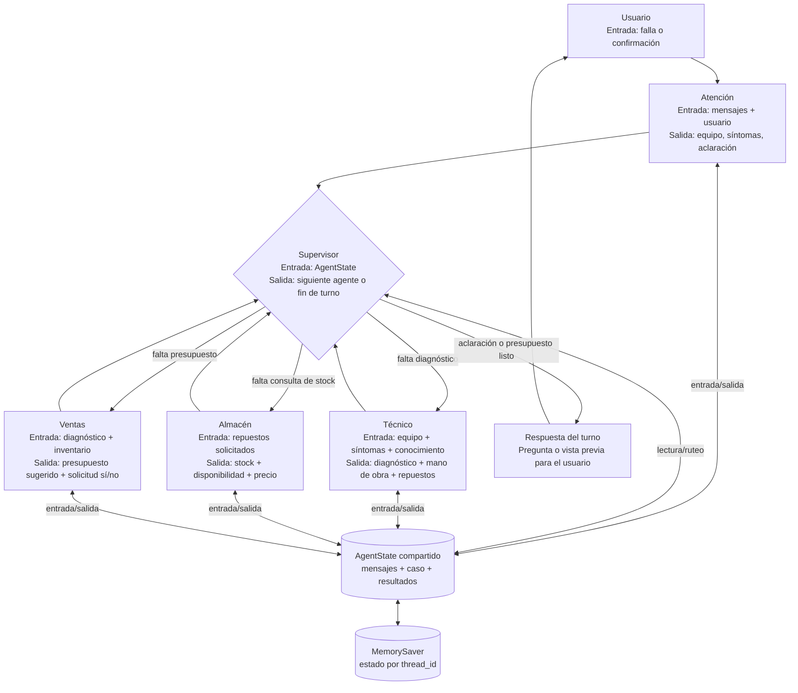
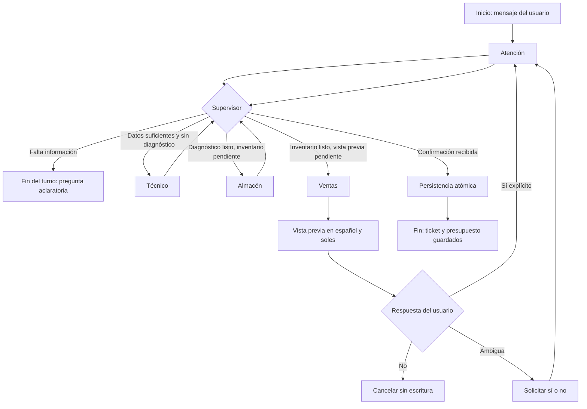

# Arquitectura del orquestador

## Resumen

El sistema usa **LangGraph** para coordinar un flujo de soporte técnico representado como un `StateGraph`. El nodo llamado `supervisor` es un router determinista: examina el estado compartido y selecciona el siguiente nodo mediante `_supervisor_route`; no utiliza un LLM para decidir las rutas.

LangChain integra los modelos de chat de Groq, la salida estructurada, los mensajes y la herramienta de consulta de inventario. LangSmith recibe las trazas cuando está habilitado mediante las variables de entorno.

## Diagrama de arquitectura



## Estructura del paquete

```text
app/agents/orquestador/
├── agentes/
│   ├── almacen.py       # Consulta y estructura de disponibilidad de repuestos
│   ├── atencion.py      # Clasificación, aclaraciones y consentimiento
│   ├── confirmation.py  # Interpreta respuestas afirmativas/negativas
│   ├── quotes.py        # Cálculo monetario determinista
│   ├── tecnico.py       # Diagnóstico provisional y recuperación RAG
│   └── ventas.py        # Vista previa y persistencia tras confirmar
├── graph/
│   ├── state.py         # Estado compartido y modelos de salida estructurada
│   └── supervisor.py    # Construcción y ruteo del StateGraph
├── knowledge/
│   ├── fallas_comunes.md
│   └── retriever.py     # Recuperación léxica BM25
└── tools/
    └── inventory.py    # Herramienta LangChain para consultar inventario
```

La interfaz de prueba está en `app/web.py`. Esta importa `build_graph` y `new_thread_id` desde el paquete `app.agents.orquestador`.

## Flujo de ejecución



1. **Atención** usa `IntakeResult` para obtener equipo, síntomas y si necesita aclaraciones. La salida solicita español y traduce los síntomas conservando marcas, modelos y significado. Las fallas de equipos se clasifican como `Soporte técnico`.
2. **Aclaraciones** terminan el turno sin crear registros. LangGraph conserva el estado para continuar con el mensaje posterior.
3. **Técnico** recupera los fragmentos Markdown más pertinentes, genera diagnóstico, mano de obra y repuestos solicitados mediante `TechnicalDiagnosis`.
4. **Almacén** consulta cada repuesto solicitado en PostgreSQL. Los precios y existencias provienen de la base de datos, no del modelo ni del catálogo Markdown.
5. **Ventas** calcula subtotales con `Decimal`, filtra componentes sin stock y construye una vista previa en español y PEN (`S/`). En esta etapa no se escribe ni ticket ni presupuesto.
6. **Consentimiento** se interpreta por reglas explícitas: respuestas afirmativas llevan a persistencia; negativas terminan sin guardar; otras respuestas solicitan un sí/no inequívoco.
7. **Persistencia** crea ticket, presupuesto y detalles dentro de una sola transacción SQL. Si falla una escritura, la transacción se revierte.

## Estado compartido

`AgentState` combina mensajes LangChain con campos tipados del caso:

| Grupo | Campos principales | Uso |
|---|---|---|
| Identidad | `user_id` | Asocia el ticket al usuario autenticado por correo. |
| Atención | `category`, `product`, `symptoms`, `clarification` | Mantiene el caso normalizado y las preguntas pendientes. |
| Control | `awaiting_clarification`, `awaiting_ticket_confirmation`, `ticket_confirmed` | Determina si el supervisor finaliza, continúa o solicita consentimiento. |
| Técnico e inventario | `diagnosis`, `labor_cost`, `requested_parts`, `inventory` | Comparte diagnóstico, costo estimado y disponibilidad real. |
| Cotización | `available_parts`, `parts_total`, `total`, `quote_preview_ready` | Construye y valida la vista previa sin persistirla. |
| Resultado | `ticket_id`, `quote_id`, `response` | Se completa después de guardar o responder al usuario. |

Los mensajes se combinan con `add_messages`. `MemorySaver` conserva checkpoints en memoria por `thread_id`; no se guardan conversaciones en PostgreSQL. La interfaz genera un hilo por sesión y lo renueva al cerrar/cancelar o completar una cotización.

## Rutas del supervisor

`_supervisor_route` aplica este orden:

- Si hay aclaración o consentimiento pendiente, termina el turno actual.
- Si existe consentimiento explícito y todavía no hay `ticket_id`, deriva a `persistencia`.
- Si falta diagnóstico, deriva a `tecnico`.
- Si falta resultado de inventario, deriva a `almacen`.
- Si falta la vista previa de cotización, deriva a `ventas`.
- En cualquier otro caso, termina el turno.

Los nodos técnicos regresan al supervisor después de completar su trabajo. Esto mantiene el ruteo centralizado y hace que las transiciones dependan del estado, no de llamadas al LLM.

## Herramientas, RAG y datos

- `tools/consultar_inventario` envuelve `lookup_inventory` como herramienta LangChain. El nodo de almacén la invoca para cada repuesto.
- `knowledge/retriever.py` divide los Markdown por encabezados `##`, normaliza tildes y clasifica coincidencias mediante BM25 local. Por defecto devuelve hasta tres fragmentos. No utiliza embeddings ni un vector store.
- `knowledge/fallas_comunes.md` orienta síntomas, diagnósticos y componentes; no es fuente de precio ni stock.
- `database/repository.py` lee `users` y `spare_parts`, y escribe en `tickets`, `quotes` y `quote_details`. La persistencia atómica ocurre después de la confirmación.

## LLM y observabilidad

`app/config.py` configura `ChatGroq` con `GROQ_API_KEY` y `GROQ_MODEL`. Atención y técnico piden resultados estructurados con modelos Pydantic. Los importes se calculan en código para no depender de aritmética generada por el LLM.

LangSmith se configura con `LANGSMITH_TRACING`, `LANGSMITH_API_KEY`, `LANGSMITH_PROJECT` y, opcionalmente, `LANGSMITH_ENDPOINT`. El grafo incluye nombre de ejecución y etiquetas para facilitar la búsqueda de trazas. El email y el nombre no se agregan al estado del grafo; `user_id` sí forma parte del estado y puede quedar asociado a la traza.

## Ejecución y pruebas

```powershell
streamlit run app/web.py
python -m unittest discover -s tests -v
```

La interfaz solicita el email de una cuenta activa en `users`, presenta el saludo y permite iniciar el flujo conversacional. Para una prueba de integración se requieren las variables de `.env`, PostgreSQL accesible y credenciales válidas de Groq/LangSmith.