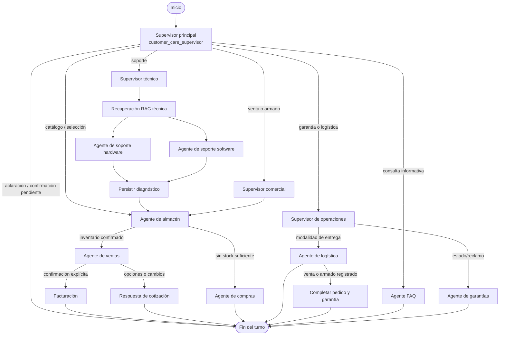

# Patrón jerárquico de atención multiagente

> Guía de lectura del código implementado en `app/agents/jerarquico/`. Este documento describe el estado actual del proyecto y ofrece espacios para añadir capturas de la arquitectura y de las conversaciones.

## 1. Objetivo del patrón

El patrón jerárquico recibe los mensajes del cliente en un supervisor principal, identifica la clase de solicitud y envía el flujo al equipo y agente especializado. Los agentes comparten un estado tipado y el flujo se controla con un grafo de LangGraph. Para diagnóstico técnico y preguntas frecuentes se recupera contexto desde documentos Markdown; para disponibilidad, precios y persistencia se consulta el repositorio PostgreSQL.

El grafo no es una colección de agentes que conversan libremente entre sí: las transiciones están declaradas en el builder y las funciones de routing deciden el siguiente nodo a partir del estado.

> **Captura por agregar:** vista general del patrón jerárquico o del grafo en LangSmith. Sugerencia de archivo: `docs/capturas/patron-jerarquico-01-grafo.png`.

## 2. Vista general del recorrido



**Archivos del flujo:** [builder.py](../app/agents/jerarquico/graph/builder.py), [routing.py](../app/agents/jerarquico/graph/routing.py) y [state.py](../app/agents/jerarquico/graph/state.py).

> **Captura por agregar:** grafo abierto en LangSmith con una ejecución de soporte o venta. Sugerencia: `docs/capturas/patron-jerarquico-02-ejecucion.png`.

## 3. Supervisor principal y supervisores de equipo

### Supervisor principal: `customer_care_supervisor`

Implementado en [supervisor.py](../app/agents/jerarquico/supervisor.py) y registrado en [builder.py](../app/agents/jerarquico/graph/builder.py). Es la entrada de cada turno. Interpreta la solicitud, conserva el contexto conversacional y decide una ruta como soporte, información/FAQ, venta, armado de PC, garantía, logística o consulta/selección de inventario. También gestiona aclaraciones, selecciones pendientes y confirmaciones antes de avanzar.

El usuario se identifica a través de la sesión autenticada que entrega la API; el supervisor usa el repositorio para asociar las operaciones al cliente. Las decisiones estructuradas se validan antes de actualizar el estado.

### Supervisores secundarios

Los nodos `commercial_team_supervisor`, `technical_team_supervisor` y `operations_team_supervisor` se definen en [agents/teams.py](../app/agents/teams.py). Hoy son enrutadores deterministas: asignan `team` al estado y el grafo dirige el trabajo al siguiente agente. No realizan por sí solos una segunda clasificación con el LLM. La lógica del dominio está en los agentes especializados que reciben el flujo.

| Supervisor de equipo | Solicitudes habituales | Delegación posterior |
| --- | --- | --- |
| Comercial | Venta individual y armado de PC | Almacén; después ventas y, si se acepta, facturación |
| Técnico | Diagnóstico de hardware o software | RAG técnico, agente especializado, persistencia y almacén |
| Operaciones | Estado/reclamo de garantía y logística | Garantía o logística |

> **Captura por agregar:** supervisor principal y campo `route`/`team` en una ejecución. Sugerencia: `docs/capturas/patron-jerarquico-03-supervisores.png`.

## 4. Agentes especializados

| Agente o nodo | Archivo | Responsabilidad dentro del flujo |
| --- | --- | --- |
| FAQ | [agents/faq.py](../app/agents/jerarquico/agents/faq.py) | Recupera secciones relevantes de la FAQ Markdown y formula una respuesta limitada a ese contexto. |
| Soporte técnico | [technical_support.py](../app/agents/jerarquico/technical_support.py) | Diagnóstico especializado en modos de hardware o software usando los documentos recuperados. |
| Recuperación de conocimiento | [knowledge_retrieval.py](../app/agents/jerarquico/knowledge_retrieval.py) | Busca hasta tres documentos y los coloca en el estado compartido para soporte. |
| Almacén | [warehouse.py](../app/agents/jerarquico/warehouse.py) | Busca artículos vigentes en el catálogo, consulta precio/stock, presenta alternativas y gestiona selección de componentes. |
| Ventas y cotizaciones | [sales.py](../app/agents/jerarquico/sales.py) | Calcula cotizaciones, valida cambios de precio y espera aceptación explícita antes de guardar. |
| Facturación | [agents/billing.py](../app/agents/jerarquico/agents/billing.py) | Registra cotización aceptada y pago pendiente; no procesa ni confirma el pago. |
| Garantías | [agents/warranty.py](../app/agents/jerarquico/agents/warranty.py) | Consulta póliza/estado y tramita el flujo asociado a reclamos. |
| Logística | [agents/logistics.py](../app/agents/jerarquico/agents/logistics.py) | Interpreta retiro presencial o courier y registra la preferencia con los datos requeridos. |
| Completar pedido | [agents/warranty.py](../app/agents/jerarquico/agents/warranty.py) | Completa los pasos posteriores a la venta/armado y registra la garantía que corresponde al flujo. |
| Compras | [agents/procurement.py](../app/agents/jerarquico/agents/procurement.py) | Informa que no puede confirmar adquisición externa cuando no hay stock ni una relación proveedor-producto cotizable. |
| Persistir diagnóstico | [persistence.py](../app/agents/jerarquico/persistence.py) | Escribe el diagnóstico técnico en el ticket existente. |

> **Captura por agregar:** ejemplo de opciones reales de inventario y posterior cotización. Sugerencia: `docs/capturas/patron-jerarquico-04-catalogo-cotizacion.png`.

## 5. Estado compartido y memoria de conversación

[ServiceState](../app/agents/jerarquico/graph/state.py) define los datos que los nodos comparten. Incluye mensajes y datos de cliente, ruta/equipo, solicitud y diagnóstico, contexto RAG, piezas requeridas, resultados y selecciones de inventario, perfil/presupuesto de armado, cotización, garantía, logística, ticket y resultado del turno.

Los campos `awaiting_*` y los datos de selección permiten que una respuesta posterior —por ejemplo, «elijo la 3» o un cambio de RAM— continúe el flujo pendiente. El grafo se compila con `InMemorySaver`; el API conserva los identificadores de conversación y el estado se reanuda por hilo mientras vive el proceso. Esta memoria no es una persistencia duradera de conversaciones entre reinicios.

## 6. Tools y acceso a datos

### Tools de consulta

[tools/database.py](../app/agents/jerarquico/tools/database.py) expone herramientas estructuradas para:

- `consultar_inventario_jerarquico`: buscar en el catálogo activo y leer precio unitario y stock actual. Es de solo lectura y no reserva existencias.
- `consultar_garantia_por_codigo`: recuperar una póliza por código exacto.

El grafo también hace operaciones de lectura/escritura mediante [ServiceRepository](../app/database/repository.py): búsqueda de clientes y productos, creación/actualización de tickets, aceptación de cotizaciones, pagos pendientes, garantías y preferencias logísticas. Esas operaciones se invocan desde los nodos y se etiquetan en las trazas como tools.

### Cálculo de cotización

[tools/quotes.py](../app/agents/jerarquico/tools/quotes.py) contiene `calculate_quote`, una función de cálculo que usa `Decimal`, valida cantidades/precios y redondea a centavos. Los precios de piezas proceden del catálogo consultado; la mano de obra se configura en [settings.py](../app/settings.py). La guía de perfiles puede proponer SKUs, pero no sustituye la verificación del catálogo vigente.

> **Captura por agregar:** tool de catálogo o consulta SQL observada en una ejecución de LangSmith, ocultando datos personales. Sugerencia: `docs/capturas/patron-jerarquico-05-tools.png`.

## 7. RAG y documentos de conocimiento

El RAG técnico está implementado en [retriever.py](../app/agents/jerarquico/retriever.py) y se invoca desde [knowledge_retrieval.py](../app/agents/jerarquico/knowledge_retrieval.py). Es recuperación léxica local sobre Markdown, no una base vectorial. Puntúa coincidencias de términos/títulos/diagnósticos y entrega un máximo de tres documentos pertinentes al estado.

| Documento de conocimiento | Uso |
| --- | --- |
| [manual_servicio.md](../app/agents/jerarquico/knowledge_base/manual_servicio.md) | Casos de fallas y procedimientos de diagnóstico/servicio. |
| [pc_build_profiles.md](../app/agents/jerarquico/knowledge_base/pc_build_profiles.md) | Perfiles y componentes sugeridos por uso; los códigos deben validarse después en el catálogo vivo. |
| [faq_servicio.md](../app/agents/jerarquico/knowledge_base/faq_servicio.md) | Información de servicios, compras, proceso, logística y otros temas frecuentes. |

La FAQ tiene su propio recuperador lexical por secciones (`MarkdownFaqRetriever`) dentro de [agents/faq.py](../app/agents/jerarquico/agents/faq.py). Para una consulta, selecciona las secciones más relacionadas y el agente responde usando ese contexto. Así, el RAG técnico y el RAG de FAQ comparten la fuente Markdown del proyecto, pero siguen rutas de recuperación separadas.

La selección de perfiles de armado se parsea desde Markdown por [pc_build_profiles.py](../app/agents/jerarquico/pc_build_profiles.py); [warehouse.py](../app/agents/jerarquico/warehouse.py) completa la propuesta consultando artículos, stock y precios actuales.

> **Captura por agregar:** documentos recuperados/contexto de una falla en LangSmith o el manual Markdown abierto. Sugerencia: `docs/capturas/patron-jerarquico-06-rag.png`.

## 8. Ciclos principales

### Consulta o selección de componente

El supervisor detecta intención de catálogo o una selección pendiente. Almacén consulta opciones reales de la base; si hay varias, el flujo espera la elección del cliente. Tras resolver los componentes, ventas calcula y presenta el importe para revisión.

### Armado de PC y cambios de cotización

Los perfiles de `pc_build_profiles.md` orientan las configuraciones; el almacén valida los SKU en la base y calcula con los precios disponibles. El cliente puede elegir una opción o pedir cambios de RAM/almacenamiento; el estado retiene la selección y se recalcula el importe. Facturación solo se alcanza al aceptar la cotización explícitamente.

### Soporte técnico

Supervisor técnico → recuperación RAG → agente hardware/software → persistir diagnóstico → almacén para piezas cotizables → ventas. El diagnóstico y los repuestos se separan: el manual propone contexto/códigos, pero disponibilidad y precio se consultan en catálogo.

### Aceptación y logística

Tras aceptar, facturación guarda la cotización y crea un pago en estado pendiente. Después se pregunta retiro presencial o courier; logística registra la preferencia. Ese registro no significa pago recibido, stock reservado ni pedido entregado. En venta o armado, el grafo continúa al nodo de completar pedido/garantía después de registrar logística.

> **Captura por agregar:** conversación completa desde selección/cambios hasta aceptación y modalidad de entrega. Sugerencia: `docs/capturas/patron-jerarquico-07-ciclo-venta.png`.

## 9. API, configuración y proveedores

- [main.py](../app/main.py) expone el chat autenticado en `/api/chat`, valida la sesión, obtiene el grafo y ejecuta el patrón solicitado.
- [combined.py](../app/combined.py) integra aplicaciones/rutas de autenticación y chat para el despliegue combinado.
- [contract.py](../app/chat/contract.py) define los modelos de entrada y salida del chat.
- [settings.py](../app/settings.py) carga configuración, credenciales de Groq/LangSmith y precios de mano de obra desde entorno.
- [trace.py](../app/agents/jerarquico/trace.py) añade trazas locales seguras para nodos y operaciones.

El modelo configurado es Groq vía `ChatGroq`. Cuando LangSmith está activado, `main.py` crea el contexto de trazado por ejecución. No incluyas valores de `.env` en capturas ni documentación.

> **Captura por agregar:** ejecución del chat autenticado en LangSmith con el flujo de nodos visible. Sugerencia: `docs/capturas/patron-jerarquico-08-langsmith.png`.

## 10. Trazabilidad y privacidad

El decorador `traced_node` registra inicio, resultado o error de cada agente. `traced_tool` hace lo mismo con operaciones de repositorio. El JSONL local (`.local/hierarchical-traces.jsonl`, configurable con `HIERARCHICAL_TRACE_PATH`) guarda fecha, identificador de ejecución, nombre/kind/evento y, en error, tipo de excepción y SQLSTATE opcional. No guarda consultas, mensajes, credenciales, entradas/salidas completas ni texto de excepción.

LangSmith es una integración distinta y su visualización depende de la configuración `LANGSMITH_*`. La API anonimiza el campo textual de error antes de enviarlo. En capturas deben ocultarse nombres, correos, direcciones, códigos de pago y cualquier otro dato del usuario.

## 11. Archivos principales, de un vistazo

```text
app/agents/jerarquico/
├── supervisor.py                 # decisión principal de ruta y continuación conversacional
├── sales.py                      # cotizaciones y respuesta de opciones/cambios
├── warehouse.py                  # inventario, alternativas y selección de componentes
├── technical_support.py          # agentes de diagnóstico hardware/software
├── retriever.py                  # recuperación lexical del RAG técnico
├── knowledge_retrieval.py        # nodo que deposita contexto RAG en el estado
├── pc_build_profiles.py          # carga de perfiles de armado Markdown
├── persistence.py                # escritura del diagnóstico en el ticket
├── trace.py                      # eventos locales seguros por agente/tool
├── graph/
│   ├── builder.py                # nodos, aristas y compilación del grafo
│   ├── routing.py                # reglas condicionales de transición
│   └── state.py                  # estado compartido de LangGraph
├── agents/
│   ├── teams.py                  # selectores secundarios de equipo
│   ├── faq.py                    # recuperación FAQ y respuesta fundamentada
│   ├── billing.py                # aceptar cotización y registrar pago pendiente
│   ├── logistics.py              # preferencia de retiro/envío
│   ├── warranty.py               # estado/reclamo/completar garantía
│   └── procurement.py            # manejo actual de falta de stock/proveedores
├── tools/
│   ├── database.py               # herramientas estructuradas de lectura
│   └── quotes.py                 # cálculo monetario con Decimal
└── knowledge_base/
    ├── faq_servicio.md
    ├── manual_servicio.md
    └── pc_build_profiles.md
```

## 12. Límites actuales

- Los supervisores secundarios solo asignan el equipo; la clasificación principal ocurre en el supervisor raíz.
- Compras no cotiza proveedores: el agente indica que el esquema actual no relaciona proveedores y productos con costos/plazos confirmables.
- El checkpoint es en memoria y no es almacenamiento durable entre reinicios del proceso.
- RAG técnico/FAQ es local y lexical; no usa embeddings ni un vector store.
- La consulta de inventario no reserva ni descuenta stock. La preferencia logística no acredita pago o entrega.
- Los perfiles Markdown orientan armado; no constituyen por sí solos una validación eléctrica/física completa de compatibilidad.
- Los datos de demostración incluidos en la FAQ deben verificarse o sustituirse antes de operación real.

## 13. Pruebas existentes y dónde encontrarlas

La cobertura del patrón está repartida entre pruebas unitarias/de integración aisladas. Estos archivos ya existen en `tests/`; esta tarea no volvió a ejecutarlos.

| Archivo | Qué cubre principalmente |
| --- | --- |
| [test_hierarchical_workflows.py](../tests/test_hierarchical_workflows.py) | Flujos completos del grafo jerárquico con modelo/repositorio simulados: venta directa, armado, elección conversacional, cambios de RAM y recálculo, límite de presupuesto, FAQ/capacidades, consultas de catálogo, soporte con RAG, logística, garantía y estado autenticado. |
| [test_multiagent_graph.py](../tests/test_multiagent_graph.py) | Nodos, routing, diagnóstico y soporte, escritura/aceptación/rechazo de cotizaciones, manejo de precios/stock, alternativas por familia, selecciones, validación de datos y cálculo `Decimal`. |
| [test_hierarchical_tracing.py](../tests/test_hierarchical_tracing.py) | Eventos de agente/tool, metadatos permitidos, errores sin texto sensible y SQLSTATE seguro. |
| [test_retriever.py](../tests/test_retriever.py) | Recuperación lexical del manual técnico, normalización de acentos/sinónimos, selección de casos y límites de contexto; incluye una consulta de horario FAQ que debe quedar fuera del RAG técnico. |
| [test_faq_retriever.py](../tests/test_faq_retriever.py) | Recuperación por tema de la FAQ y cobertura de servicios, ubicación, horario, pagos, proceso, garantía, logística, compras y cotizaciones. |
| [test_repository.py](../tests/test_repository.py) | Operaciones del repositorio con sesiones/resultados simulados: clientes, inventario, tickets, diagnósticos, cotizaciones/pagos transaccionales y logística. |
| [test_repository_inventory.py](../tests/test_repository_inventory.py) | Prueba de lectura de inventario usando la configuración de base prevista por ese caso; revisar el código antes de ejecutarla porque puede requerir una BD disponible. |
| [test_pattern_api.py](../tests/test_pattern_api.py) | Contrato de API para selección de patrón, autenticación, mapeo de cotización/ticket y persistencia vía grafo simulado. |
| [test_api.py](../tests/test_api.py) y [test_combined_api.py](../tests/test_combined_api.py) | Endpoints del chat y aplicación combinada/auth, incluyendo integración de rutas y control de acceso. |
| [test_quotes.py](../tests/test_quotes.py) | Cálculos de cotización del patrón de orquestador anterior; no es la prueba específica de `tools/quotes.py` jerárquico. |

### Pruebas aisladas frente a scripts con dependencias externas

La mayor parte de los archivos anteriores usa fakes, mocks o SQLite en memoria y puede ejecutarse como suite aislada según las dependencias instaladas. `test_repository_inventory.py` y los scripts `test_rag_soporte.py` / `test_rag_tecnico.py` pueden requerir configuración o servicios externos; consulta su contenido y variables requeridas antes de usarlos. No tomes una prueba que consulta PostgreSQL como puramente aislada.

Comandos de referencia para los grupos aislados (ejecútalos en el entorno del proyecto):

```powershell
pytest tests/test_hierarchical_workflows.py tests/test_multiagent_graph.py
pytest tests/test_hierarchical_tracing.py tests/test_retriever.py tests/test_faq_retriever.py
pytest tests/test_pattern_api.py tests/test_api.py tests/test_combined_api.py
```

> **Captura por agregar:** salida de la suite aislada en terminal o reporte del IDE. Sugerencia: `docs/capturas/patron-jerarquico-09-pruebas.png`.

## 14. Checklist de capturas sugeridas

1. Grafo del flujo jerárquico (`patron-jerarquico-01-grafo.png`).
2. Traza LangSmith de una conversación con nodos principales (`...-02-ejecucion.png`).
3. Enrutamiento y equipos (`...-03-supervisores.png`).
4. Opciones del catálogo y cotización (`...-04-catalogo-cotizacion.png`).
5. Consulta de tools (`...-05-tools.png`).
6. Recuperación desde los Markdown (`...-06-rag.png`).
7. Cambios, aceptación y logística (`...-07-ciclo-venta.png`).
8. Chat autenticado con trazabilidad (`...-08-langsmith.png`).
9. Ejecución o reporte de pruebas aisladas (`...-09-pruebas.png`).

Coloca las imágenes en `docs/capturas/` y reemplaza los bloques “Captura por agregar” por imágenes Markdown, por ejemplo: ``.
